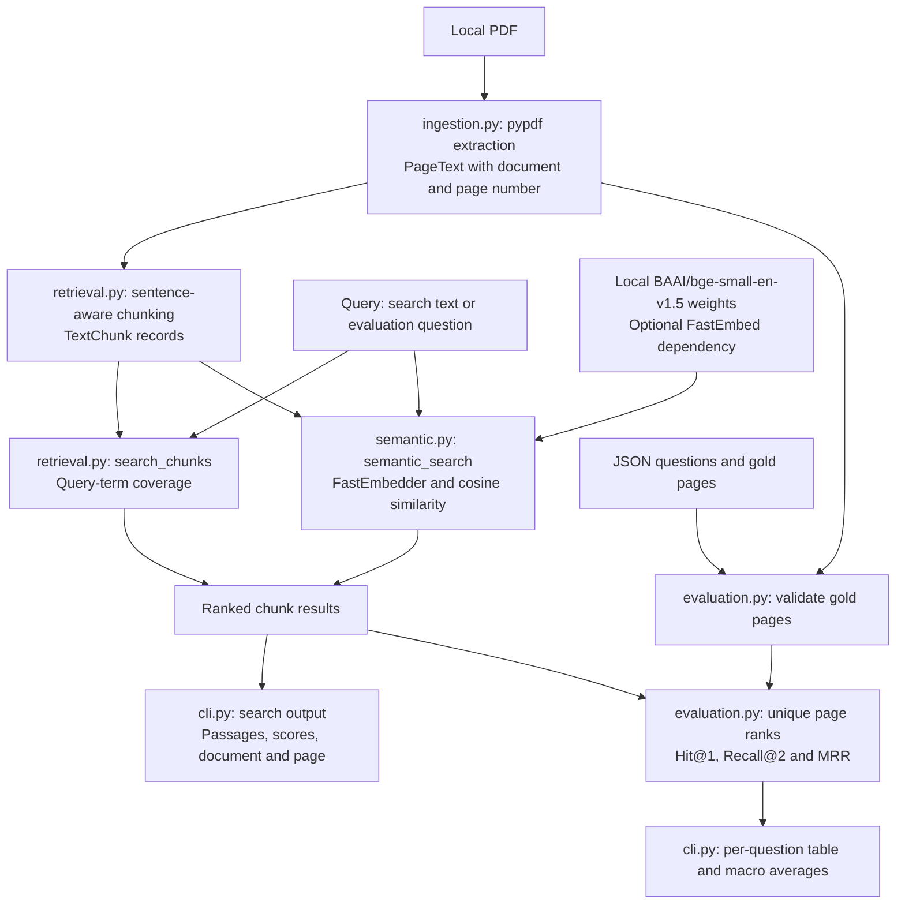

# Financial Research Copilot

Find relevant passages in a financial report, inspect their source pages, and
measure whether retrieval finds the expected evidence.

Financial research often starts with locating a number, an obligation, or a
risk disclosure buried in a PDF. This project provides a small local CLI for
that step. It extracts text, ranks passages, and reports source metadata so a
researcher can check the original document.

## What works today

| Implemented | Planned, not implemented |
| --- | --- |
| Text extraction from one local PDF with page metadata | Evidence-backed answer generation |
| Deterministic sentence-aware chunks and chunk inspection | Validated answer citations and insufficient-evidence answers |
| Lexical search, with up to five ranked chunks by default | Multi-document retrieval and persistent indexes |
| Optional local FastEmbed semantic retrieval adapter | UI, deployment, and MCP integrations |
| Page retrieval evaluation with validated JSON labels | A broader independently labeled financial benchmark |

The CLI returns passages rather than generated answers. Document name and
one-based PDF viewer page number are source metadata, not a complete citation
system. Real-model semantic quality remains unmeasured.

[Verified status and evaluation history](../../docs/PROJECT_STATUS.md)
· [Portfolio overview](../../README.md)
· [Roadmap](../../docs/roadmap.md)

## Quickstart

Requirements: Python 3.12 and `uv`. From the repository root:

```bash
cd projects/financial-research-copilot
uv sync --locked
uv run --offline --no-sync frc search tests/fixtures/synthetic_financial_report.pdf "ceramic housings"
```

`uv sync --locked` installs the locked dependencies into the project environment
and may need network access. All subsequent commands below run from this
project directory. If the environment is already installed, skip the sync step.
The lexical workflow needs no model weights, API key, or paid service.

### Actual CLI example

A researcher looking for the response to a component sourcing risk searches
for `ceramic housings`. The command above produces:

```text
Result 1:
Document: synthetic_financial_report.pdf
Page: 4
Score: 1.00
Passage: Supplier risk remains a material operating consideration. The largest sensor component supplier provided 34 percent of annual component purchases, while the five largest suppliers provided 68 percent. Management is qualifying a second source for ceramic housings and plans to hold additional safety stock.
```

This output was captured from the included fictional report. `Score` is the
fraction of unique query terms found in the chunk, not answer confidence.
Lexical ranking lowercases word-like terms, includes common words, and breaks
ties by document name, page number, and chunk index.

### Inspect text and chunks

The smaller two-page fixture provides a minimal extraction check:

```bash
uv run --offline --no-sync frc ingest tests/fixtures/synthetic_report.pdf
```

Inspect the four-page report's chunks with their document, page, chunk index,
word count, and text:

```bash
uv run --offline --no-sync frc chunks tests/fixtures/synthetic_financial_report.pdf --chunk-size 80
```

Search uses a default maximum of 80 words per chunk and no overlap. Chunking
keeps complete sentences together where they fit, balances sentence groups,
and falls back to word windows for oversized sentences. To inspect optional
complete-sentence overlap:

```bash
uv run --offline --no-sync frc chunks tests/fixtures/synthetic_financial_report.pdf --chunk-size 80 --sentence-overlap 1
```

These diagnostic options do not change normal search defaults. To use a
different local text-layer PDF, replace the fixture path in the commands.

## Current architecture



`cli.py` coordinates these components. Evaluation validates labels and checks
for an empty corpus before retrieving each question. It requests all ranked
chunks, then deduplicates pages in first-seen order. Normal search requests at
most five chunks. The semantic adapter embeds passages and queries locally;
its retrieval instruction is prepended only to the query. There is no vector
database, model API, generated-answer stage, or persistent index.

## Reproducible page-level evaluation

The [JSON fixture](tests/fixtures/financial_report_eval.json) contains 12
manually labeled questions about the four-page fictional Asteron Ledger report.
Three questions require evidence from two pages. Labels use extracted,
one-based PDF viewer page numbers.

```bash
uv run --offline --no-sync frc eval tests/fixtures/synthetic_financial_report.pdf \
  --method lexical --dataset tests/fixtures/financial_report_eval.json
```

The command prints retrieved and gold pages plus metrics for every question.
Its actual aggregate row is:

```text
Average | - | - | 0.917 | 0.958 | 0.958
```

| Method and dataset | Hit@1 | Recall@2 | MRR |
| --- | ---: | ---: | ---: |
| Lexical, current 12-question fixture | 0.917 | 0.958 | 0.958 |
| Semantic, same fixture | Not measured | Not measured | Not measured |

Lexical results were verified on 2026-10-31. The enclosure paraphrase ranks its
gold page second; the final multi-page question ranks one gold page third.
See [project status](../../docs/PROJECT_STATUS.md#evaluation-fixture-revisions)
for the four question revisions, evidence rationale, and historical results.
Retrieval algorithms were unchanged between those measurements.

### Metric definitions and limits

For each question, let `G` be its non-empty gold page set and `P` the ordered
unique retrieved pages:

- Hit@1 is `1` if the first page in `P` belongs to `G`, otherwise `0`.
- Recall@2 is `|set(P[:2]) intersect G| / |G|`.
- Reciprocal rank is `1 / r`, where `r` is the first relevant page's one-based
  rank anywhere in `P`; it is `0` when no relevant page is retrieved. MRR is
  the mean reciprocal rank.

Each aggregate is the arithmetic mean across all questions, including
zero-result questions. Empty retrieval or no relevant retrieved page scores
zero for all metrics. An entirely empty extracted corpus is instead a setup
error. Hit@1 and MRR reward finding any gold page, not all multi-page evidence.

These are page retrieval measurements, not answer accuracy. A chunk can rank a
page highly without containing the specific passage needed to answer the
question. Four synthetic pages with one topic per page, 12 manual labels, no
independent held-out set, and no unanswerable cases do not form a real-world
accuracy benchmark. The fixture also does not measure financial tables,
footnotes, cross-document reasoning, or production latency.

## Optional semantic retrieval

The existing optional adapter uses FastEmbed's CPU/ONNX runtime and
`BAAI/bge-small-en-v1.5`. Inference runs locally. Model setup needs disk space
and may download weights; CPU latency and memory use have not been measured
here. Cosine similarity is a ranking signal, not calibrated confidence.

For a reader choosing to install the optional extra:

```bash
uv sync --locked --extra semantic
```

If weights are absent, a first semantic search without offline mode may
download the configured model:

```bash
uv run --no-sync frc search tests/fixtures/synthetic_financial_report.pdf \
  "Can the company cover its near-term obligations?" --method semantic
```

With both the dependency and model weights already available, force an offline
run:

```bash
HF_HUB_OFFLINE=1 uv run --offline --no-sync frc search tests/fixtures/synthetic_financial_report.pdf \
  "Can the company cover its near-term obligations?" --method semantic
HF_HUB_OFFLINE=1 uv run --offline --no-sync frc eval tests/fixtures/synthetic_financial_report.pdf \
  --method semantic --dataset tests/fixtures/financial_report_eval.json
```

The offline commands fail rather than download if weights are missing. The
semantic benchmark is pending because cached weights were unavailable at
review; no semantic scores or lexical-versus-semantic quality advantage are
claimed. The optional [smoke script](scripts/semantic_smoke.py) is a manual
model integration check, outside test discovery; it may download weights when
run without offline mode.

## Tests and failure behavior

Run the complete offline suite in the existing project environment:

```bash
uv run --offline --no-sync python -m unittest discover -s tests -v
```

All **41 tests passed** locally on 2026-10-31. Tests use synthetic PDF fixtures
and fake vectors, covering ingestion errors, chunking, lexical ranking,
semantic cosine ranking and CLI wiring, metric averaging, duplicate pages,
invalid labels, and empty corpora. They need no network, secrets, or live
model calls. The repository's [test workflow](../../.github/workflows/ci.yml)
configures automated runs; this local verification makes no claim about a
remote CI run. No formatter or type checker is configured.

Search with no matches prints `No matches found.` and returns status 0.
Invalid PDF paths, empty search queries, and invalid evaluation data return
status 2. Evaluation rejects labels absent from the actual extracted page set
and PDFs producing no chunks, with actionable error messages.

## Known limitations

- Extraction needs a text layer; there is no OCR. Layout, tables, charts, and
  reading order depend on the PDF and `pypdf`.
- Chunks do not retain paragraph structure, character offsets, or full context
  across boundaries. Optional overlap duplicates text and is off for search.
- Page numbers follow the PDF viewer's one-based order, not printed page labels.
  Dataset validation checks page membership, not a document hash; use the
  matching fixture PDF.
- Lexical matching can rank incidental words highly. Semantic ranking reflects
  a general English model and is not specialized for finance.
- Every command extracts and chunks anew; semantic evaluation re-embeds the
  corpus for each question. No persistence or performance guarantee exists.
- Generated answers, answer-level citations, and an insufficient-evidence
  answer path are planned. A returned passage is not a verified financial
  conclusion or investment recommendation.

The documented retrieval workflow keeps PDF text local and makes no paid
model API calls. Use public or synthetic documents when sharing examples.

## Upcoming roadmap

1. Measure the existing semantic baseline on the same revised fixture when
   local weights are available.
2. Broaden independently labeled evaluation with harder financial evidence,
   ratios, and insufficient-evidence cases before selecting retrieval changes.
3. Design evidence-constrained answers with validated page citations and an
   insufficient-evidence path, tested with deterministic fakes.

Multi-document retrieval, a UI, deployment, and MCP integrations remain later
work. See [project status](../../docs/PROJECT_STATUS.md#next-planned-milestones)
and the [repository roadmap](../../docs/roadmap.md) for the current boundaries.
